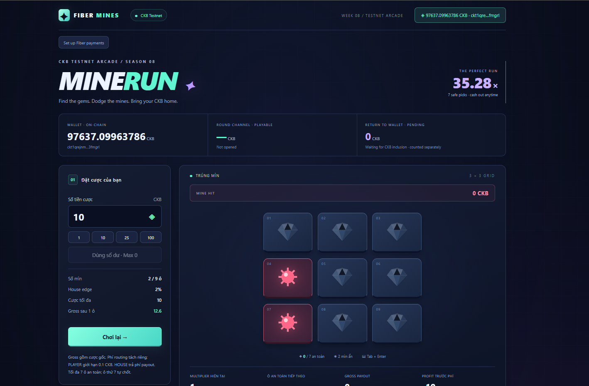
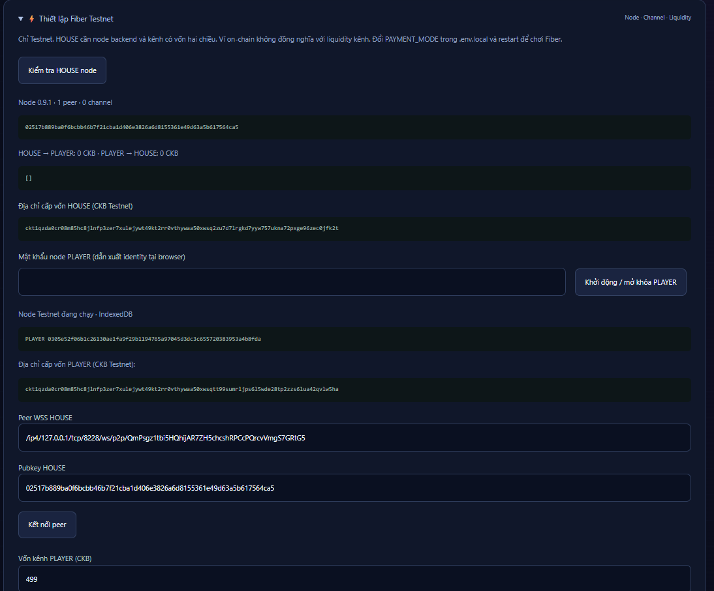
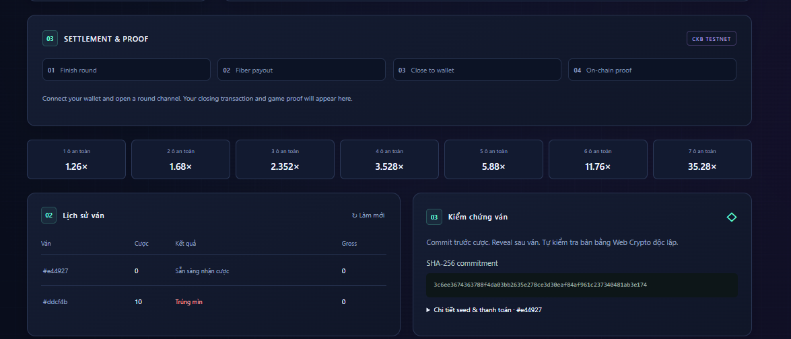

# CKBuilder Weekly Dev Log — Week08

**Project:** Fiber Mines — CKB Testnet arcade
**Participant:** Trung Do
**Evidence date:** November 5, 2026
**Network:** CKB Testnet

## 1. Overview

This week I built Fiber Mines, a 3×3 mines game that connects a CKB Testnet wallet with a browser PLAYER Fiber node and a native HOUSE Fiber node. The server commits to a board before the player provides a client seed and pays a stake. The application implements stake, payout, channel funding, liquidity checks, settlement, history and result verification.

The seven screenshots in [evidence/](evidence/) show the running application, Fiber configuration, a browser PLAYER identity, a 10 CKB mine-loss result and the history/proof interface. They do **not** show a ready funded channel, a successful Fiber payment or a confirmed CKB settlement transaction. The current channel recovery work addresses a PLAYER channel reported as `SHUTTING_DOWN`; that state must finish closing before a new channel can be funded.

## 2. Environment

| Component | Configuration |
| --- | --- |
| App | Next.js 16.4.5, React 19.2.0, TypeScript 5.9.3 |
| Runtime | Node.js 22.16+, pnpm 10.11 |
| Fiber | FNN 0.9.1; browser SDK `@fiber-pay/sdk` 0.3.3 |
| Wallet integration | CCC connector for an external CKB Testnet wallet |
| Storage | SQLite for game state; browser IndexedDB for the PLAYER Fiber identity |
| Local app | `http://localhost:3000` |
| Payment configuration | `PAYMENT_MODE=fiber` in private `.env.local` |

The HOUSE RPC is called by the server. The browser connects to the HOUSE P2P peer. Passwords, wallet keys and RPC tokens are not part of the evidence.

## 3. Work completed

- Built the mines interface with a 3×3 board, two mines, seven safe picks, stake controls, cashout, result history and a proof panel.
- Kept on-chain wallet capacity, playable channel liquidity and pending return as separate balances.
- Added PLAYER node unlock, HOUSE node inspection, peer connection, channel funding and directional liquidity controls.
- Added wallet-signed external funding and retained recovery data for an opening request with an uncertain result.
- Added HOUSE invoice creation and a PLAYER-to-HOUSE payment path to rebalance a ready channel.
- Added server commitment, automatically generated client seed, deterministic board verification and exact integer CKB payout calculations.
- Added Fiber stake and payout status handling, duplicate-send protection and cooperative channel-close tracking.
- Updated channel-state handling so a `SHUTTING_DOWN` channel cannot be presented as one that can simply be opened and signed again. A replacement round channel is prepared only after the previous settlement is confirmed and the old channel has closed.

These are implemented application flows. The screenshots establish only the visible states specified below.

## 4. Screenshot evidence

| File | What the image actually shows |
| --- | --- |
| [01_Channel_running.png](evidence/01_Channel_running.png) | FNN watchtower periodic checks completing in a terminal. This supports that the node process was active at capture time; it does not show channel readiness. |
| [02_UI.png](evidence/02_UI.png) | Fiber Mines on CKB Testnet with a connected wallet, a 10 CKB mine-loss screen and 0 CKB gross result. The playable channel section says `Not opened`. |
| [03_Setup_FiberChannel.png](evidence/03_Setup_FiberChannel.png) | The browser PLAYER node unlock form and explanation that an external wallet signs channel funding. No node is unlocked in this capture. |
| [04_Channel_Funding.png](evidence/04_Channel_Funding.png) | A PLAYER Fiber public key, 499 CKB funding field and button to prepare funding. The image reports 0 CKB available and `Channel: Not opened`; it does not show a signed funding transaction. |
| [05_Config_payment.png](evidence/05_Config_payment.png) | HOUSE FNN 0.9.1 with one peer, zero channels and 0 CKB in both channel directions. The panel also shows the browser PLAYER identity, funding addresses and a local WS peer address. |
| [06_Ready_to_Bet.png](evidence/06_Ready_to_Bet.png) | An unplayed board with a 10 CKB stake, 2% house edge, 1.26× first safe-pick multiplier and an automatically filled client seed. “Ready to receive stake” is a game state, not proof that channel liquidity is available; the control shows `Max 0`. |
| [07_Proof_n_Historic.png](evidence/07_Proof_n_Historic.png) | Settlement/proof steps, payout multipliers, a history row for a 10 CKB mine loss and a SHA-256 commitment. The settlement panel says a wallet and round channel must be connected; no closing transaction or verified receipt is shown. |







The screenshots were captured at different stages. The visible mine-loss result and the later `Not opened` channel display do not establish a complete, independently verified Testnet payment lifecycle.

## 5. Current status

| Item | Evidence-backed result |
| --- | --- |
| Native HOUSE process | Watchtower logs visible in image 01; HOUSE 0.9.1 and one peer shown in image 05 |
| HOUSE channel liquidity | Image 05 shows zero channels and zero liquidity in both directions |
| Browser PLAYER identity | Public key shown in images 04 and 05 |
| Channel funding | Preparation UI shown; no signed or confirmed funding transaction in this evidence set |
| Game | 10 CKB mine-loss result visible in images 02 and 07 |
| Fiber stake payment | No payer `Success` and matching receiver `Paid` evidence in these images |
| Winning payout | Not shown; the illustrated result is a loss |
| Channel return and settlement | No confirmed close transaction or receipt in these images |

The latest application status separately reported a PLAYER round channel as `SHUTTING_DOWN`. The app now displays that state as a closing channel and blocks another funding attempt until the prior settlement is confirmed. This status is not independently proven by the seven screenshots.

## 6. Problems and lessons

The main integration difficulty was distinguishing wallet capacity from Fiber liquidity. A funded CKB wallet can still have zero spendable balance in its round channel. The HOUSE and PLAYER balances have opposite payment directions, so a stake and a winning payout require checking different outbound sides.

Channel operations have intermediate states. A prepared transaction is not a signed funding transaction, `CHANNEL_READY` is required before play, and `SHUTTING_DOWN` cannot be reopened. A response with an unknown result must be reconciled against both nodes and the chain before any retry. The browser identity and its storage must remain available while funds or a close are pending.

The proof interface commits to the game result before the stake, then uses the client seed and revealed server seed for verification. A commitment shown in the UI is useful audit data; a completed payment and settled return need their own payment and transaction evidence.

## 7. Next steps

1. Reconcile the old PLAYER channel and settlement until the close is confirmed. Check both PLAYER and HOUSE channel lists and the CKB closing transaction.
2. Open a fresh round channel, approve its funding in the connected Testnet wallet and capture `CHANNEL_READY` with both directional balances.
3. Capture one stake invoice with the same payment hash showing PLAYER `Success` and HOUSE `Paid`.
4. Complete a winning round and capture matching payout statuses, then the confirmed cooperative close and receipt verification.

Until those captures exist, this report claims the implemented workflow and visible game/UI states, not a complete verified Testnet money round.

## 8. Reproduction

Start the native HOUSE node in one PowerShell window:

```powershell
Set-Location "$HOME\.fiber"
.\start-node.ps1
```

Start the app from `G:\neon\week08` in another window:

```powershell
pnpm dev
```

Open `http://localhost:3000`. Use the wallet that funds the round channel and unlock the original PLAYER Fiber identity in the same browser profile. The [README](README.md) contains configuration and recovery steps.
